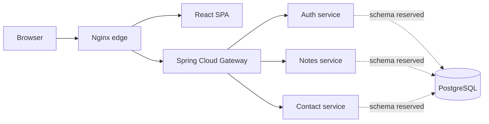

# Architecture

## Runtime shape

The edge owns the browser-facing entry point. `/api/**` is forwarded to the gateway, while all other requests go to the frontend container. The gateway routes API prefixes to their owning service. Services are isolated build artifacts and have independent Dockerfiles.

## Platform contracts

`platform/bom` centralizes dependency versions and contains no runtime code. `platform/api-contracts` holds the public OpenAPI documents. Changes to a contract should be reviewed alongside its service and frontend consumer.

## Current scaffold boundaries

The auth service issues RS256 JWTs and publishes a JWKS, but its development user store and signing key are in memory. Notes and contact messages are also in-memory. PostgreSQL and schema/role initialization are provisioned for the persistence phase but are not yet wired to these services. The contact inbox requires a configured admin token, but the token is not user/role based. These implementations are for local development and must be replaced or hardened before production.

The `phase-1` through `phase-4` tags are intended milestones, not created tags. Capture completed evidence in `docs/evidence/phase-N/` before tagging a phase.